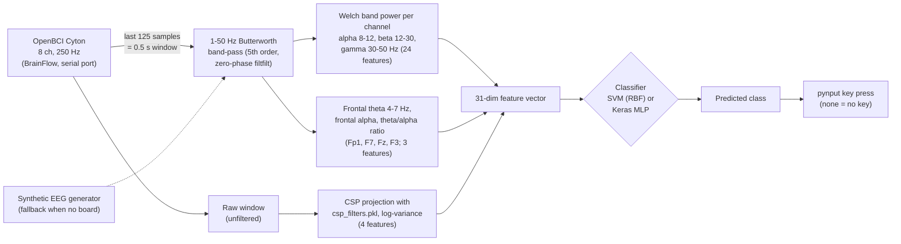
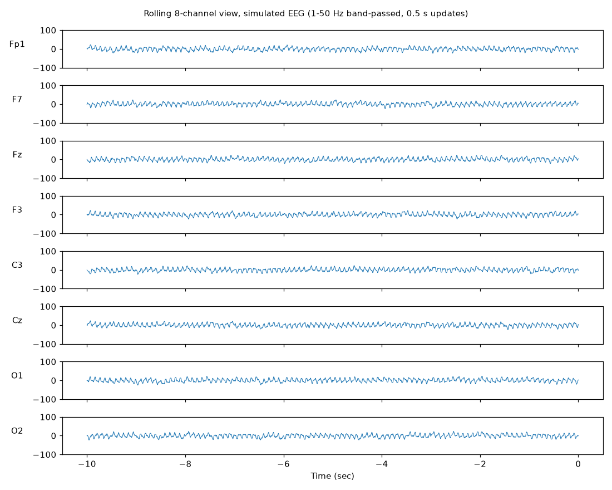
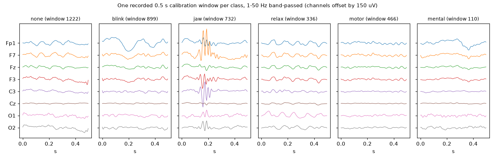
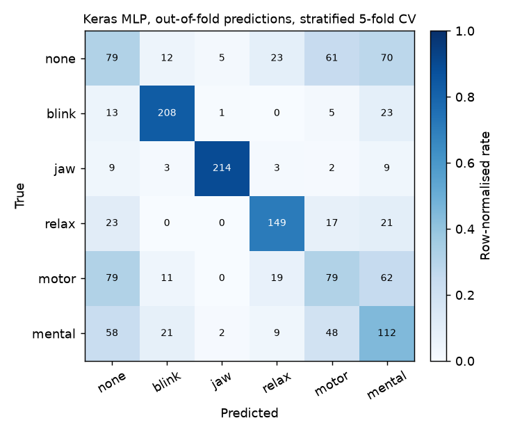

# SynapseShift: EEG-to-Keyboard Control

A real-time brain-computer interface (BCI) prototype that turns 8-channel EEG from an OpenBCI Cyton board into keyboard presses. A Tkinter app records labelled calibration windows, trains a classifier (an RBF SVM or a small Keras MLP), and then classifies the live signal about every 0.5 s, pressing the key mapped to each predicted class. A rolling 10-second, 8-channel plot shows the signal while it runs.

The goal is hands-free control from signals a person can produce on purpose: eye blinks, jaw clenches, relaxation, motor and mental-load states. Each one maps to a key such as Up, Down or Space.

> **Status: research prototype.** On the included recordings the best model gets **about 58% held-out accuracy across six classes** (chance is 17%). Blink and jaw are reliable; the "none", "motor" and "mental" classes are not (see [Results](#results)). Treat it as a working pipeline, not a finished input device.

## Pipeline



## The six classes

Class indices come from the order of `ACTIONS` in `ControlSys.py`. The key mapping is fixed in code.

| Index | Class | Key pressed | What the code uses it for |
|---|---|---|---|
| 0 | `none` | *(nothing)* | baseline / no command |
| 1 | `blink` | Down arrow | eye blink |
| 2 | `jaw` | Up arrow | jaw clench |
| 3 | `relax` | Space | relaxed state |
| 4 | `motor` | Caps Lock | motor (imagery); the CSP filters are fitted for this class vs. the rest |
| 5 | `mental` | Shift | mental load; the frontal theta/alpha features target this |

## Signal processing and features

Everything below is in `ControlSys.py` (`filter_eeg`, `extract_features`, `extract_all_features`, `extract_csp_features`).

1. **Acquisition.** BrainFlow `get_current_board_data(125)` gives the latest 0.5 s at 250 Hz, and only the 8 EEG channels are kept. Electrodes are assumed to be `Fp1, F7, Fz, F3, C3, Cz, O1, O2`, in that order.
2. **Filtering.** A 5th-order Butterworth band-pass from 1 to 50 Hz is applied with `scipy.signal.filtfilt` (zero phase), separately on each 0.5 s window.
3. **Spectral features (24).** For each channel, Welch PSD gives the mean power in the alpha (8–12 Hz), beta (12–30 Hz) and gamma (30–50 Hz) bands.
4. **Mental-load features (3).** On the frontal channels Fp1, F7, Fz and F3, the code computes mean theta (4–7 Hz) power, mean alpha power, and the theta/alpha ratio.
5. **CSP features (4).** `ComputeCSPFilter.py` implements Common Spatial Patterns from scratch:
   - It averages the per-window covariance matrices for the target class (`motor`) and for all other windows.
   - It solves the generalised eigenproblem `C_motor · w = λ (C_motor + C_rest) · w` with `scipy.linalg.eigh`.
   - It keeps the 2 eigenvectors with the largest and the 2 with the smallest eigenvalues, giving 4 spatial filters with shape `(4, 8)`.
   - At run time each raw window is projected onto these filters, and the feature is `log(var + 1e-6)` of each projection.

   The committed `csp_filters.pkl` is exactly what this script produces from the full committed calibration file. I checked this by refitting.
6. **Classifiers.**
   - **SVM:** `SVC(probability=True, decision_function_shape='ovr')` with default hyper-parameters.
   - **MLP:** Keras `Dense` layers 256-64-128-64-32-64-(Dropout 0.1)-64-6 with GELU/ELU/LeakyReLU/ReLU activations, a softmax output, Adam, and 20 epochs.

   Neither model applies feature scaling. Models are saved to `models/model_svm.pkl` or `models/model_dl.h5`.

## Running it

### Install

Python 3.12 was used (on Windows 11; TensorFlow on native Windows is CPU-only).

```bash
python -m venv .venv
.venv\Scripts\activate          # Windows  (source .venv/bin/activate elsewhere)
pip install -r requirements.txt
```

On Windows, `pip install tensorflow` can fail with `OSError: [Errno 2] No such file or directory: ...client_side_weighted_round_robin.upb.h`. The TensorFlow wheel contains a 163-character file path, so a virtual environment inside a deeply nested folder goes past the 260-character `MAX_PATH` limit. Either enable Windows long-path support or create the virtual environment at a shorter path.

### Simulated mode (no hardware)

```bash
python ControlSys.py
```

If no board can be opened on the configured serial port, the app prints `Error initializing board: UNABLE_TO_OPEN_PORT_ERROR ... Falling back to simulated EEG data.` and runs on a synthetic generator. The generator makes 10, 20 and 40 Hz sine waves with random phase plus Gaussian noise, with the same spectrum on every channel whatever class you are recording. You can also set `SIMULATED = True` at the top of `ControlSys.py`.

In simulated mode the whole GUI works: collection, training, live classification and the plot. But the synthetic signal carries no class information, so predictions are meaningless. Two cautions:

- **The app presses real keys.** "Start EEG Processing" sends key presses through `pynput` to whatever window has focus, in simulated mode too. Stop it, or focus a harmless window, before you start it.
- **Collection appends to the dataset.** "Start Collection" appends new windows to `data/calibration_data.pkl`. In simulated mode that mixes synthetic windows into the recorded data, so work on a copy if you want to keep the original.



*The app's rolling view (10 s, 8 channels, ±100 µV), rendered off-screen from the built-in simulated generator with the app's own filter. Reproduce with `python docs/make_figures.py`.*

### With an OpenBCI Cyton

1. Set the serial port in `initialize_board()`. It is hard-coded as `params.serial_port = 'COM7'`; use your dongle's port, for example `COM3` or `/dev/ttyUSB0`.
2. Place the electrodes in the order `Fp1, F7, Fz, F3, C3, Cz, O1, O2`, on Cyton channels 1–8.
3. Run `python ControlSys.py`. The window title is *EEG Keyboard Control System*, and it shows the mode, the classifier type and the model stats.
4. **Start Collection.** For each of the six classes in turn, a dialog asks you to get ready. The app then records 10 windows of 0.5 s each, one per second, and asks whether to keep them. Kept windows are appended to `data/calibration_data.pkl`.
5. **Run `python ComputeCSPFilter.py`** to refit `csp_filters.pkl` on the updated data. Training does not do this automatically (there is a `TODO` in the code).
6. **Train Model.** This trains the selected classifier on all calibration data and saves it. *Toggle Classifier (SVM/DL)* switches the type and loads the saved model of that type, if one exists.
7. **Start EEG Processing** classifies the live signal, presses keys, and opens the rolling plot. **Stop EEG Processing** stops both. **Exit** closes the BrainFlow session.

I did not test this hardware path (no board was available). Everything in this README about live use comes from reading the code.

## Data

`data/calibration_data.pkl` (11.7 MB, committed on 2025-03-20 in "Updating Code and calibration after experience at lab") is a pickled dict `{"features": [...], "labels": [...]}`:

- **1450 windows**, each a `float64` array of shape **(8 channels, 125 samples)**, which is 0.5 s at **250 Hz**.
- Labels are integers 0–5. Windows per class: none 250, blink 250, jaw 240, relax 210, motor 250, mental 250.
- Recorded in **25 collection sessions** of 10 consecutive windows per class, in class order. In 5 sessions one class was discarded (relax four times, jaw once).
- The values are **raw, unfiltered Cyton samples in microvolts**, with large per-channel DC offsets: channel means range from about −3,700 to +28,000 µV, while the typical within-window standard deviation is 4–19 µV. The spectrum has a clear 60 Hz mains peak. Nothing in this file looks like the app's simulated generator, so it appears to be a real recording.

This is raw EEG recorded from a person. The repository does not say who the subject was, or whether there was more than one.



*One randomly chosen window per class, band-passed with the app's filter. The blink window shows the large Fp1 deflection typical of an eye blink, and the jaw window shows a high-frequency muscle (EMG) burst on most channels.*

## Results

Measured with `python evaluate.py` (about 4 minutes on a 14-core CPU; results were identical on two runs).

| Model | Accuracy the app displays (scored on its own training data) | Stratified 5-fold CV accuracy | 5-fold macro-F1 | Leave-one-session-out accuracy (worst-best session) | LOSO macro-F1 |
|---|---|---|---|---|---|
| SVM (RBF, default C) | 0.561 | **0.553** ± 0.004 | 0.523 | **0.547** (0.40–0.65) | 0.514 |
| Keras MLP (20 epochs) | 0.762 | **0.580** ± 0.028 | 0.589 | **0.582** (0.45–0.70) | 0.590 |

Chance level is 0.172, the share of the largest class.

**Method.**
- `evaluate.py` calls the app's own `extract_all_features` and the from-scratch `compute_csp_filters`.
- The CSP filters are **refitted on each training fold**. Using the committed `csp_filters.pkl` would leak test labels, because it was fitted on all 1450 windows.
- The two models are built exactly as in `train_model`, with no feature scaling and seed 0.
- *Stratified 5-fold* shuffles windows across folds.
- *Leave-one-session-out* holds out each of the 25 collection sessions in turn, which is closer to "calibrate, then use later". The two schemes agree to within a point, so neighbouring windows from the same recording block are not inflating the 5-fold score much.
- The training-set column is what the GUI's "Accuracy" shows after *Train Model*. For the MLP it overstates held-out accuracy by about 18 points.



**Per-class recall (MLP, 5-fold):** blink 0.83, jaw 0.89, relax 0.71, mental 0.45, none 0.32, motor 0.32. Blinks and jaw clenches are large artefacts that are easy to detect. `none`, `motor` and `mental` are mostly confused with each other. The CSP filters are fitted for `motor`, yet `motor` is the class recognised least well.

**Caveats.**
- All data is from one calibration file, and the number of subjects is not recorded.
- Windows are 0.5 s, so theta (4–7 Hz) and alpha estimates rest on only 2–3 cycles.
- These are offline window-level accuracies, not closed-loop typing performance.

## Limitations and known issues

- **The app reports training accuracy.** The stats panel scores the model on the data it was just trained on. Use `evaluate.py` for honest numbers.
- **The serial port is hard-coded** (`COM7`). Any board error silently falls back to simulated data, and the GUI then shows "Simulated EEG Mode".
- **CSP is not refitted during training.** You have to run `ComputeCSPFilter.py` by hand after collecting new data. `extract_csp_features` also reloads `csp_filters.pkl` from disk for every window.
- **No feature scaling.** Band powers on raw µV span several orders of magnitude, which hurts the RBF SVM.
- **Every prediction becomes a key press.** There is no confidence threshold and no smoothing across windows. With about 58% accuracy, wrong keys will be pressed.
- **Threading.** The live plot is created from a worker thread, and matplotlib warns *"Starting a Matplotlib GUI outside of the main thread will likely fail."* In my run on Windows it did open and update. Clicking Stop and then Start within about a second can leave the old processing loop running alongside the new one, which I saw once.
- **Library deprecations.** The model is saved as legacy HDF5 (`.h5`), and Keras warns about it. scikit-learn 1.9 deprecates `SVC(probability=True)`; it still works with the versions pinned here.
- **The calibration data is personal.** `data/calibration_data.pkl` is raw EEG from a person, committed to the public history.

## Repository layout

```
ControlSys.py          Tkinter app: acquisition (BrainFlow / simulated), filtering, features, SVM/MLP training,
                       live classification -> pynput key presses, rolling 8-channel plot
ComputeCSPFilter.py    From-scratch CSP (scipy.linalg.eigh); fits filters for "motor" vs rest -> csp_filters.pkl
csp_filters.pkl        4 x 8 CSP filters fitted on the full calibration file
data/
  calibration_data.pkl 1450 labelled raw EEG windows (8 x 125, 250 Hz), see "Data"
evaluate.py            Held-out evaluation (stratified 5-fold and leave-one-session-out) -> docs/confusion_matrix.png
docs/
  make_figures.py      Renders the README figures off-screen (Agg)
  *.png                Figures used in this README
requirements.txt       Direct dependencies at the versions used
```

`models/` (trained models) is created by the app at run time and is not part of the repository.
