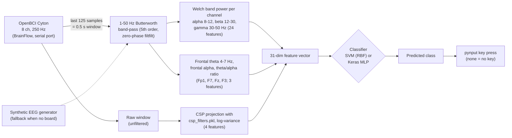

# SynapseShift: EEG-to-Keyboard Control

SynapseShift is a real-time brain-computer interface (BCI) that turns 8-channel EEG from an OpenBCI Cyton board into keyboard presses. A Tkinter app records labelled calibration windows and trains a classifier, either an RBF SVM or a small Keras MLP. It then classifies the live signal about every 0.5 s and presses the key mapped to each predicted class. A rolling 10-second, 8-channel plot shows the signal while it runs.

I wanted hands-free control from signals a person can produce on purpose: blinking, clenching the jaw, closing the eyes and relaxing, motor imagery, and mental load. Each one maps to a key such as Up, Down or Space.

> **Status: research prototype.** On my recordings the best model gets **about 58% held-out accuracy across six classes** (chance is 17%). Folding the weakest class, motor, into "none" (the way I ran the final demo) raises that to 68–70%. For the SVM it also cuts wrong key presses from 43% of windows to 10%. Blink and jaw are reliable; "none", "motor" and "mental" are not (see [Results](#results)).

## Background

I built SynapseShift for COGS 189, the brain-computer interface course at UC San Diego.

For the course demo I used it to scroll and control YouTube Shorts hands-free:
- jaw clench and blink moved up and down the feed;
- closing my eyes and relaxing toggled pause/play (Space);
- mental load was bound to mute.

Mental load was the hardest state to trigger on purpose, so that control was hit-or-miss. The other controls worked close to every time. That figure is from memory of the live run, not a measurement; the offline numbers are lower (see [Results](#results)).

Motor was the least reliable class. For the final run-through I treated it the same as "none", so it never pressed a key. That made the right key come up much more often and left almost no misinputs.

The demo recording isn't in this repository.

## Pipeline



## The six classes

Class indices follow the order of `ACTIONS` in `ControlSys.py`, and the keys below are the ones mapped there.

| Index | Class | Key pressed | What it is |
|---|---|---|---|
| 0 | `none` | *(nothing)* | baseline, no command |
| 1 | `blink` | Down arrow | eye blink |
| 2 | `jaw` | Up arrow | jaw clench |
| 3 | `relax` | Space | eyes closed, meditating (alpha rhythm) |
| 4 | `motor` | Caps Lock | motor imagery; the CSP filters are fitted for this class against the rest |
| 5 | `mental` | Shift | mental load; the frontal theta/alpha features target this |

The code in this repository still has all six classes, with motor on Caps Lock and mental on Shift. To reproduce the final demo setup, make `perform_action` skip `motor` the way it already skips `none`.

## Signal processing and features

Everything below is in `ControlSys.py` (`filter_eeg`, `extract_features`, `extract_all_features`, `extract_csp_features`).

1. **Acquisition.** BrainFlow's `get_current_board_data(125)` gives the latest 0.5 s at 250 Hz, and only the 8 EEG channels are kept. The electrodes are, in order, `Fp1, F7, Fz, F3, C3, Cz, O1, O2`.
2. **Filtering.** A 5th-order Butterworth band-pass from 1 to 50 Hz is applied with `scipy.signal.filtfilt` (zero phase), separately on each 0.5 s window.
3. **Spectral features (24).** For each channel, Welch PSD gives the mean power in the alpha (8–12 Hz), beta (12–30 Hz) and gamma (30–50 Hz) bands.
4. **Mental-load features (3).** On the frontal channels Fp1, F7, Fz and F3, I compute mean theta (4–7 Hz) power, mean alpha power, and the theta/alpha ratio.
5. **CSP features (4).** `ComputeCSPFilter.py` is my from-scratch implementation of Common Spatial Patterns:
   - It averages the per-window covariance matrices for the target class (`motor`) and for all other windows.
   - It solves the generalised eigenproblem `C_motor · w = λ (C_motor + C_rest) · w` with `scipy.linalg.eigh`.
   - It keeps the 2 eigenvectors with the largest and the 2 with the smallest eigenvalues, giving 4 spatial filters with shape `(4, 8)`.
   - At run time each raw window is projected onto these filters, and the feature is `log(var + 1e-6)` of each projection.

   The committed `csp_filters.pkl` is exactly what this script produces from the full calibration file (re-checked by refitting in November 2026).
6. **Classifiers.**
   - **SVM:** `SVC(probability=True, decision_function_shape='ovr')` with default hyper-parameters.
   - **MLP:** Keras `Dense` layers 256-64-128-64-32-64-(Dropout 0.1)-64-6 with GELU/ELU/LeakyReLU/ReLU activations, a softmax output, Adam, and 20 epochs.

   Neither model uses feature scaling. Models are saved to `models/model_svm.pkl` or `models/model_dl.h5`.

## Running it

### Install

I last ran this with Python 3.12 on Windows 11. TensorFlow on native Windows is CPU-only, which is fine here.

```bash
python -m venv .venv
.venv\Scripts\activate          # Windows  (source .venv/bin/activate elsewhere)
pip install -r requirements.txt
```

On Windows, `pip install tensorflow` can fail with `OSError: [Errno 2] No such file or directory: ...client_side_weighted_round_robin.upb.h`. The TensorFlow wheel contains a 163-character file path, so a virtual environment inside a deeply nested folder goes past the 260-character `MAX_PATH` limit. Either enable Windows long-path support or create the virtual environment at a shorter path.

### Simulated mode (no hardware)

```bash
python ControlSys.py
```

If no board can be opened on the configured serial port, the app prints `Error initializing board: UNABLE_TO_OPEN_PORT_ERROR ... Falling back to simulated EEG data.` and runs on a synthetic generator instead. You can also set `SIMULATED = True` at the top of `ControlSys.py`.

The generator makes 10, 20 and 40 Hz sine waves with random phase plus Gaussian noise. Every channel gets the same spectrum, whatever class you are recording, so the signal carries no class information. The whole GUI works in this mode (collection, training, live classification and the plot), but the predictions mean nothing.

Two cautions:

- **The app presses real keys.** "Start EEG Processing" sends key presses through `pynput` to whatever window has focus, in simulated mode too. Focus a harmless window before you start it.
- **Collection appends to the dataset.** "Start Collection" appends new windows to `data/calibration_data.pkl`. In simulated mode that mixes synthetic windows into the real recordings, so work on a copy if you want to keep the original.


*The app's rolling view (10 s, 8 channels, ±100 µV), rendered off-screen from the simulated generator with the app's own filter. Reproduce with `python docs/make_figures.py`.*

### With an OpenBCI Cyton

1. Set the serial port in `initialize_board()`. It is hard-coded as `params.serial_port = 'COM7'`; change it to your dongle's port, for example `COM3` or `/dev/ttyUSB0`.
2. Place the electrodes in the order `Fp1, F7, Fz, F3, C3, Cz, O1, O2`, on Cyton channels 1–8.
3. Run `python ControlSys.py`. The window, *EEG Keyboard Control System*, shows the mode, the classifier type and the model stats.
4. **Start Collection.** For each of the six classes in turn, a dialog asks you to get ready. The app then records 10 windows of 0.5 s each, one per second, and asks whether to keep them. Kept windows are appended to `data/calibration_data.pkl`.
5. **Run `python ComputeCSPFilter.py`** to refit `csp_filters.pkl` on the updated data. Training doesn't do this yet; there is a `TODO` for it.
6. **Train Model.** This trains the selected classifier on all calibration data and saves it. *Toggle Classifier (SVM/DL)* switches the type and loads the saved model of that type, if one exists.
7. **Start EEG Processing** classifies the live signal, presses keys, and opens the rolling plot. **Stop EEG Processing** stops both, and **Exit** closes the BrainFlow session.

The recordings in `data/` come from my sessions with a real Cyton board, committed in March 2025. I didn't have the board when I wrote this README in November 2026. Instead I re-ran the app in simulated mode and ran the offline evaluation below, so the live steps above are written from the code rather than re-tested.

## Data

`data/calibration_data.pkl` (11.7 MB, committed on 2025-03-20) is a pickled dict `{"features": [...], "labels": [...]}`. I recorded all of it on myself, wearing the electrodes, and I'm sharing it so the results below can be reproduced.

- **1450 windows**, each a `float64` array of shape **(8 channels, 125 samples)**, which is 0.5 s at **250 Hz**.
- Labels are integers 0–5. Windows per class: none 250, blink 250, jaw 240, relax 210, motor 250, mental 250.
- The windows form **25 collection sessions** of 10 consecutive windows per class, in class order. In 5 sessions I discarded one class (relax four times, jaw once). This is the format and block structure the app's *Start Collection* step writes.
- The values are **raw, unfiltered Cyton samples in microvolts**, with large per-channel DC offsets. Channel means range from about −3,700 to +28,000 µV, while the typical within-window standard deviation is 4–19 µV. There is a clear 60 Hz mains peak.


*One randomly chosen window per class, band-passed with the app's filter. The blink window shows the large Fp1 deflection of an eye blink, and the jaw window shows a high-frequency muscle (EMG) burst on most channels.*

## Results

I measured these with `python evaluate.py`. It takes about 4 minutes on a 14-core CPU, and two runs gave identical results.

| Model | Accuracy the app displays (scored on its own training data) | Stratified 5-fold CV accuracy | 5-fold macro-F1 | Leave-one-session-out accuracy (worst-best session) | LOSO macro-F1 |
|---|---|---|---|---|---|
| SVM (RBF, default C) | 0.561 | **0.553** ± 0.004 | 0.523 | **0.547** (0.40–0.65) | 0.514 |
| Keras MLP (20 epochs) | 0.762 | **0.580** ± 0.028 | 0.589 | **0.582** (0.45–0.70) | 0.590 |

Chance level is 0.172, the share of the largest class.

**Method.**
- `evaluate.py` uses the app's own `extract_all_features` and my `compute_csp_filters`.
- The CSP filters are **refitted on each training fold**. The committed `csp_filters.pkl` was fitted on all 1450 windows, so using it would leak the test labels.
- Both models are built exactly as in `train_model`, with no feature scaling and seed 0.
- *Stratified 5-fold* shuffles windows across folds.
- *Leave-one-session-out* holds out each of the 25 collection sessions in turn, which is closer to "calibrate, then use later". The two schemes agree to within a point, so neighbouring windows from the same recording block aren't inflating the 5-fold score much.
- The training-set column is what the GUI's "Accuracy" shows after *Train Model*. For the MLP it overstates held-out accuracy by about 18 points.


**Per-class recall (MLP, 5-fold):** jaw 0.89, blink 0.83, relax 0.71, mental 0.45, none 0.32, motor 0.32.
- Blinks and jaw clenches are large artefacts that are easy to pick up.
- `none`, `motor` and `mental` mostly get confused with each other.
- The CSP filters are fitted for `motor`, yet `motor` is recognised least well.

That's the same ranking I saw in the live demo.

**Folding motor into none.** This is what I did for the final run-through. The table applies it after prediction to the same out-of-fold predictions; the models are not retrained on five classes. "Wrong-key rate" is the share of windows in which a key is pressed that isn't the intended one.

| Model | 6-class accuracy | Wrong-key rate, 6 classes | Accuracy, motor folded into none | Wrong-key rate, motor folded into none |
|---|---|---|---|---|
| SVM (RBF, default C) | 0.553 | 0.427 | **0.697** | **0.098** |
| Keras MLP (20 epochs) | 0.580 | 0.294 | **0.677** | **0.203** |

Folding motor into none removes most of the wrong presses, especially for the SVM: it predicts `motor` often, and those predictions stop pressing a key. For the MLP, most of the wrong presses that remain are false `mental` predictions: 185 of the 297 windows, per the confusion matrix above. That fits how unreliable mute was in the demo.

**Caveats.**
- All of the data comes from me, in one calibration file, so these numbers say nothing about how well it works for other people.
- Windows are 0.5 s long, so the theta (4–7 Hz) and alpha estimates rest on only 2–3 cycles.
- These are offline, window-by-window accuracies, not closed-loop performance.

## Limitations and known issues

- **The app reports training accuracy.** The stats panel scores the model on the data it was just trained on. Use `evaluate.py` for honest numbers.
- **The serial port is hard-coded** (`COM7`). Any board error silently falls back to simulated data; the GUI then shows "Simulated EEG Mode".
- **CSP isn't refitted during training.** You have to run `ComputeCSPFilter.py` by hand after collecting new data. `extract_csp_features` also reloads `csp_filters.pkl` from disk for every window.
- **No feature scaling.** Band powers on raw µV span several orders of magnitude, which hurts the RBF SVM.
- **Every prediction becomes a key press.** There is no confidence threshold and no smoothing across windows. At about 58% six-class accuracy, wrong keys will be pressed.
- **Threading.** The live plot is created from a worker thread, and matplotlib warns *"Starting a Matplotlib GUI outside of the main thread will likely fail."*
  - In a November 2026 run on Windows the plot did open and update.
  - In the same run, clicking Stop and then Start within about a second once left the old processing loop running alongside the new one.
- **Library deprecations.** The model is saved as legacy HDF5 (`.h5`), and Keras warns about it. scikit-learn 1.9 deprecates `SVC(probability=True)`, though it still works with the versions pinned here.
- **Single subject.** The calibration data is mine, so a new user has to record their own before training.

## Repository layout

```
ControlSys.py          Tkinter app: acquisition (BrainFlow / simulated), filtering, features, SVM/MLP training,
                       live classification -> pynput key presses, rolling 8-channel plot
ComputeCSPFilter.py    From-scratch CSP (scipy.linalg.eigh); fits filters for "motor" vs rest -> csp_filters.pkl
csp_filters.pkl        4 x 8 CSP filters fitted on the full calibration file
data/
  calibration_data.pkl 1450 labelled raw EEG windows (8 x 125, 250 Hz), see "Data"
evaluate.py            Held-out evaluation (stratified 5-fold and leave-one-session-out) -> docs/confusion_matrix.png
docs/
  make_figures.py      Renders the README figures off-screen (Agg)
  *.png                Figures used in this README
requirements.txt       Direct dependencies at the versions used
```

`models/` (trained models) is created by the app at run time and is not part of the repository.
